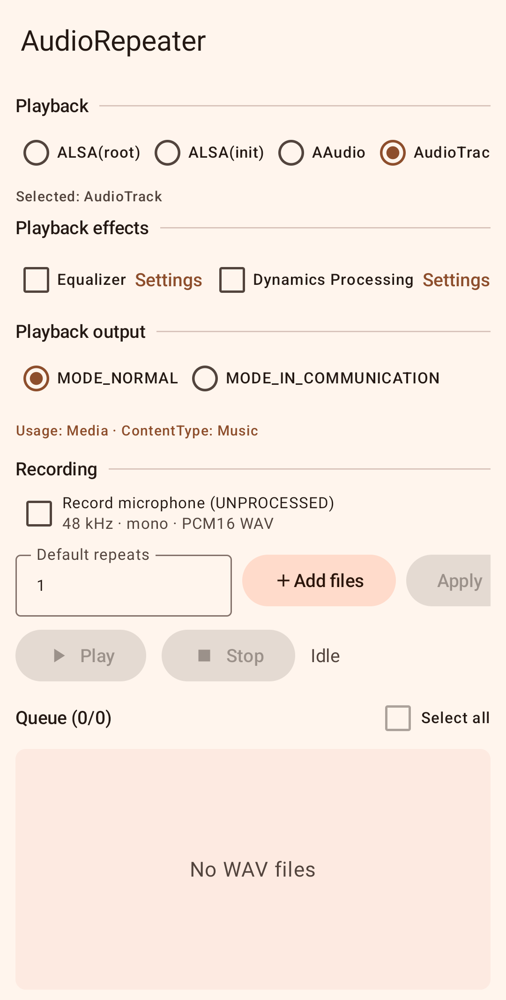

# AudioRepeater

AudioRepeater queues WAV files with per-file repeat counts and configurable
repeat and file delays. The repository contains an Android app and an iOS app.
App labels, status messages, and errors use English.

## Android



Open `Android` in Android Studio. The app requires Android 9 (API 28) or later.
Use JDK 17 and the Android SDK/NDK versions requested by Gradle. A local
`Android/local.properties` can specify your SDK path; this file is ignored.

```powershell
cd Android
.\gradlew.bat :app:assembleDebug :app:testDebugUnitTest :app:lintDebug
```

The debug APK is written to `Android/app/build/outputs/apk/debug/app-debug.apk`.
Install it on a selected device with `adb -s DEVICE_SERIAL install -r APK_PATH`.
Debug APKs retain ADB playback controls for local experiments. Release builds
ignore those controls and do not scan the debug audio directory.

The screen contains Playback, Playback effects, Playback output, and Recording:

- Select one playback path: ALSA(root), ALSA(init), AAudio, or AudioTrack.
- ALSA(root) requires root access. ALSA(init) appears only for the supported
  Pixel 4 build and kernel. See [Direct ALSA](Android/DIRECT_ALSA.md).
- AudioTrack supports Equalizer or Dynamics Processing, output selection,
  Usage, and ContentType. Communication mode offers receiver and speaker output.
- Record the microphone alongside playback with the UNPROCESSED input source.
- Adjust repeats and delays in the horizontal controls row.

App audio and settings are excluded from Android cloud backup and device
transfer. Export recordings manually before removing the app or replacing a
phone. Updates installed with `adb install -r` retain existing app data.

## iOS

See [iOS setup](iOS/README.md) for Xcode builds, signing, remote playback, and
the optional IOAudio2 bridge. Device identifiers, SSH configuration, and Apple
team identifiers must be supplied locally.

The iOS app offers AVAudioEngine and RemoteIO, five-band EQ, native dynamics
processing, System/Speaker/Receiver output, microphone recording during
playback, and a persistent queue. See the [Windows installation guide](iOS/WINDOWS_INSTALL.md)
to build and install an IPA without a local Mac.
